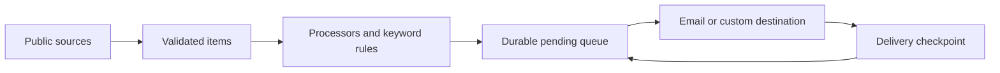

# InfoRelay

**Your sources. Your rules. Your inbox.**

[简体中文](README.zh-CN.md) · [User guide](docs/en/guide.md) · [Build your own](docs/en/architecture.md) · [Configuration](docs/en/configuration.md)

[](https://github.com/CHESHIRECAT-FINANCE/tibo-tweet-mail/actions/workflows/tests.yml) [](LICENSE)

InfoRelay turns public information into personal subscriptions. Follow a blog, watch a website, track a GitHub release, read X posts, or receive a daily market digest. Keep the updates you care about and deliver them to your email.

Run it on your computer with a guided console, or on GitHub Actions while your computer is off. Developers can replace the sources, processing steps, destination and checkpoint storage through documented Python interfaces.


## Choose your starting point

| I want to… | Start here |
|---|---|
| Get useful updates without writing code | [Download the source ZIP](https://github.com/CHESHIRECAT-FINANCE/tibo-tweet-mail/archive/refs/heads/main.zip), unzip it, then follow **Quick start** below |
| Keep receiving updates while my computer is off | [GitHub Actions guide](docs/en/guide.md#run-on-github-actions) |
| Build a custom pipeline | [Extension guide and architecture](docs/en/architecture.md) |
| Run on a server or NAS | [Docker and command-line setup](docs/en/guide.md#server-and-docker) |

## Quick start

You need **Python 3.9+**, an internet connection, and an email provider that supports SMTP with an app password or authorization code. InfoRelay does not require an account or a paid AI service.

1. Download and unzip the project. If Python is missing, install it from [python.org](https://www.python.org/downloads/). On Windows, enable **Add Python to PATH**.
2. Start the launcher: **Windows:** double-click `start.bat`. **macOS:** double-click `start.command`. **Linux / terminal:** run `python3 start.py` from the project folder. The first launch creates a local virtual environment and installs the declared dependencies. If macOS refuses to launch the file, run `python3 start.py` in Terminal.
3. In the browser, choose sources, select your email provider, and enter your email app password. The recipient defaults to the sending address and can be changed.
4. Click **Save & check**, then **Send one test email**. After checking your inbox, tick the delivery checkbox and click **Start automatic checks**.

The console opens at `http://127.0.0.1:8766`. Keep the launcher and computer running. Closing the browser tab does not stop checks; closing the launcher does. Restart checks from the console after restarting the launcher.

**Already have Python and prefer the terminal?**

```sh
python3 -m venv .venv
# macOS / Linux:
source .venv/bin/activate
# Windows PowerShell instead: .venv\Scripts\Activate.ps1
python -m pip install -r requirements.txt
python -m info_relay serve
```

[Detailed instructions, email setup and troubleshooting →](docs/en/guide.md)

## What you can subscribe to

| Source | What it tracks | Example |
|---|---|---|
| RSS / Atom | New feed items | Blog posts and news feeds |
| Website text | Changes in public page text | A release page or public announcement |
| GitHub | New Releases, optionally prereleases | `cli/cli` |
| X | Public posts through FxTwitter | A creator or product account; optional usage-reset filter |
| Daily markets | CNY exchange rates, WTI/Brent oil and gold futures | One digest after your chosen local hour |

Each source has include/exclude keywords, any/all matching, a pause switch and a first-run policy. Existing feed items are skipped by default. Website monitoring records the first snapshot, then reports transitions—including A → B → A. Markets send that day’s digest once it is due.

## Two experiences, one engine

**For everyday use:** a Chinese/English setup wizard, provider presets, live preview, connection checks, a test-email button, start/stop controls and visible runtime results. The local console stores your settings only when you save them. It never returns a saved email password to the browser.

**For builders:** a versioned plugin contract for sources, processors and destinations; JSON and SQLite checkpoint stores; a Python API, installable CLI, working plugin examples and a headless Docker configuration. No extension is loaded from a subscription JSON: trusted plugins must be explicitly registered or loaded with `--plugin`.



Try a pipeline that writes to local JSON files and **does not send email**:

```sh
python -m info_relay preview --config examples/diy.json
python -m info_relay run --config examples/diy.json --state .inforelay/diy-state.json
```

See [`examples/custom_plugin.py`](examples/custom_plugin.py) for a JSON source, a word-count processor and a Markdown destination implemented without editing the engine.

## Reliability and limits

- Pending items are saved before delivery and removed only after a destination reports success. A failing source does not block healthy sources. Cloud checkpoints use Fernet authenticated encryption on a separate `inforelay-state` branch.
- Delivery is **at least once**, not exactly once. A server may accept a message before a connection or checkpoint failure is observed; a retry can produce a duplicate. Custom destinations receive a stable batch ID for deduplication.
- GitHub scheduling is best effort. A requested 10-minute interval is not a timing guarantee. Long inactivity may disable scheduled workflows. Local mode requires a running computer.
- Built-in sources are public HTTP(S) only. There is no JavaScript browser rendering, login, private API access or paywall support. X and market adapters depend on third-party availability.
- Response windows and state are bounded: 2 MB per response, up to 1,000 feed items, 10 GitHub releases, 20 X posts, 500 pending items and 5,000 remembered IDs per source, 20 MB total checkpoint size. Long outages can miss items no longer present at the source. Keywords examine the title and the retained first 10,000 body characters.
- This is a personal, single-writer tool. The local console binds only to `127.0.0.1`; it is not a public or multi-user hosting service. Plugins are trusted code with the permissions of your Python process.

Version 0.2 adds tested extension boundaries and a guided local runtime. It is an early open-source release; see the [compatibility and upgrade policy](docs/en/architecture.md#compatibility-and-upgrades).

## Existing Tibo subscriptions

Your original `tibo_tweet_mail.py`, `mail-state`, `TIBO_MAIL_CONFIG` and `MAIL_ENABLED` continue using their existing settings. The new workflow is opt-in and uses separate configuration and state. [Legacy guide](docs/legacy.md).

## Documentation and community

- [English user guide](docs/en/guide.md) / [中文使用指南](docs/zh/guide.md)
- [English architecture and extension guide](docs/en/architecture.md) / [中文架构与扩展指南](docs/zh/architecture.md)
- [Configuration reference](docs/en/configuration.md) / [中文配置参考](docs/configuration.md)
- [Contributing](CONTRIBUTING.md), [security policy](SECURITY.md), [changelog](CHANGELOG.md), [MIT license](LICENSE)

The documentation structure draws inspiration from [changedetection.io](https://github.com/dgtlmoon/changedetection.io), [Apprise](https://github.com/caronc/apprise) and [Folo](https://github.com/RSSNext/Folo): explain the outcome first, show a direct starting path, and keep developer details in dedicated guides.
