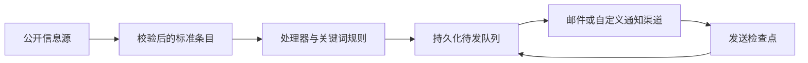

# InfoRelay · 信息订阅助手

**自己的信息源，自己的规则，自己的收件箱。**

[English](README.md) · [使用指南](docs/zh/guide.md) · [架构与 DIY](docs/zh/architecture.md) · [配置参考](docs/configuration.md)

[](https://github.com/CHESHIRECAT-FINANCE/tibo-tweet-mail/actions/workflows/tests.yml) [](LICENSE)

把你关心的公开信息，按自己的条件送到邮箱。订阅博客、监控网页文字变化、跟踪 GitHub 新版本、关注 X 动态，或每天收到一封行情简报。

普通用户通过中文向导完成设置；开发者可以替换信息源、处理器、通知渠道和状态存储。两条路径使用同一个发送引擎。


## 选一条适合你的路线

| 你想做什么 | 从这里开始 |
|---|---|
| 不写代码，先收到有用的信息 | [下载源码 ZIP](https://github.com/CHESHIRECAT-FINANCE/tibo-tweet-mail/archive/refs/heads/main.zip)，解压后按下方“快速开始”操作 |
| 电脑关机后也能自动发送 | [GitHub 云端运行指南](docs/zh/guide.md#在-github-云端运行) |
| 最大限度地 DIY 信息流 | [底层架构与插件开发](docs/zh/architecture.md) |
| 部署到服务器或 NAS | [Docker 与命令行](docs/zh/guide.md#服务器与-docker) |

## 快速开始

准备 **Python 3.9+**、网络，以及支持 SMTP 授权码或应用专用密码的邮箱。不需要注册 InfoRelay，也不需要购买 AI 服务。

1. 下载并解压项目。没有 Python 时，先从 [python.org](https://www.python.org/downloads/) 安装；Windows 安装时勾选 **Add Python to PATH**。
2. **Windows：**双击 `start.bat`。**macOS：**双击 `start.command`。**Linux / 终端：**进入项目目录运行 `python3 start.py`。首次启动会准备独立运行环境并安装声明的依赖。如果 macOS 提示不能执行，在终端运行 `python3 start.py`。
3. 浏览器中依次选择内容、选择邮箱服务商、填写邮箱授权码。收件地址默认与发件地址相同，也可以改成其他邮箱。
4. 点击 **保存并检查**，再点击 **发一封测试邮件**。确认收到后，勾选自动发送许可，点击 **开启自动订阅**。

本地控制台地址是 `http://127.0.0.1:8766`。请保持电脑和启动窗口运行。关闭浏览器标签不会停止订阅，关闭启动窗口会停止；重新启动后，需要在页面再次开启。

熟悉终端的用户也可以运行：

```sh
python3 -m venv .venv
# macOS / Linux：
source .venv/bin/activate
# Windows PowerShell 改为：.venv\Scripts\Activate.ps1
python -m pip install -r requirements.txt
python -m info_relay serve
```

[完整教程、邮箱设置和故障排查 →](docs/zh/guide.md)

## 支持的信息

| 信息源 | 获取内容 | 示例 |
|---|---|---|
| RSS / Atom | 订阅源的新条目 | 博客文章、资讯 |
| 网页文字 | 公开页面提取文字的变化 | 公告页、版本页面 |
| GitHub | 新 Release，可选预发布 | `cli/cli` |
| X | 通过 FxTwitter 获取公开帖子 | 关注账号、可选只收用量重置通知 |
| 每日行情 | 人民币汇率、WTI / 布伦特原油、黄金期货 | 每天指定小时后发送一次 |

每个来源都能独立暂停，设置包含词、排除词、任一 / 全部匹配，以及首次是否发送历史内容。默认先记录已有条目，之后有新内容才发送；网页 A → B → A 也算新变化；行情到时段后发送当天日报。

## 简单使用，也能深入改造

**普通用户：**中英文向导、邮箱预设、实际内容预览、连接检查、测试邮件、开始 / 停止和可见运行结果。点击保存才写入本机，已经保存的邮箱密码不会回传到页面。

**开发者：**带版本的 Source / Processor / Channel 插件接口，JSON / SQLite 状态存储，Python API、可安装的 CLI、可运行的插件示例，以及无界面的 Docker 部署。订阅 JSON 不能导入代码；必须显式注册插件或使用 `--plugin` 加载可信模块。



先试一个**只写本地文件、不发邮件**的信息流：

```sh
python -m info_relay preview --config examples/diy.json
python -m info_relay run --config examples/diy.json --state .inforelay/diy-state.json
```

[`examples/custom_plugin.py`](examples/custom_plugin.py) 演示了不修改引擎就添加 JSON 信息源、词数过滤器和 Markdown 输出。

## 可靠性与使用范围

- 先保存待发内容，再提交发送；目标确认成功后才从队列移除。单个来源失败不影响其他来源。云端状态使用 Fernet 认证加密，保存在独立 `inforelay-state` 分支。
- 使用“至少一次”投递语义。邮件服务器已接受、但连接或状态保存失败时，重试可能重复通知，不能承诺“恰好一次”。自定义渠道能使用稳定批次 ID 做幂等去重。
- GitHub 的 10 分钟是请求检查频率，调度可能延迟或跳过，长期不活跃也可能停用。需要严格时效时使用常驻服务器。
- 内置来源只支持公开 HTTP(S)，不执行网页 JavaScript，不支持登录、私有 API 或付费墙。X 和行情依赖第三方服务。
- 每次响应最多 2 MB；feed 最多 1000 条；GitHub 最近 10 个 Release、X 最近 20 条。单来源最多 500 条待发、5000 个已见 ID；状态共 20 MB。长时间停机可能错过已离开来源窗口的内容。关键词只检查标题和保留的前 10000 个正文字符。
- 这是个人、单写入者工具。本地控制台只监听 `127.0.0.1`，不作为公共多人服务。插件拥有 Python 进程权限，只加载可信代码。

0.2 版增加了经过测试的扩展边界和本地向导，仍属于早期开源版本。[兼容与升级约定](docs/zh/architecture.md#兼容与升级)写明了哪些接口可以依赖。

## 原有 Tibo 邮件

`tibo_tweet_mail.py`、`mail-state`、`TIBO_MAIL_CONFIG`、`MAIL_ENABLED` 继续沿用原配置。新订阅工作流默认关闭，使用独立配置和状态。[旧版指南](docs/legacy.md)。

## 文档与参与

- [中文使用指南](docs/zh/guide.md) / [English guide](docs/en/guide.md)
- [中文架构与扩展指南](docs/zh/architecture.md) / [English architecture](docs/en/architecture.md)
- [配置参考](docs/configuration.md)、[贡献指南](CONTRIBUTING.md)、[安全政策](SECURITY.md)、[更新记录](CHANGELOG.md)、[MIT 许可证](LICENSE)

介绍方式参考了 [changedetection.io](https://github.com/dgtlmoon/changedetection.io)、[Apprise](https://github.com/caronc/apprise) 和 [Folo](https://github.com/RSSNext/Folo)：先说明使用结果，给出明确入口，再将开发细节放进专门文档。
