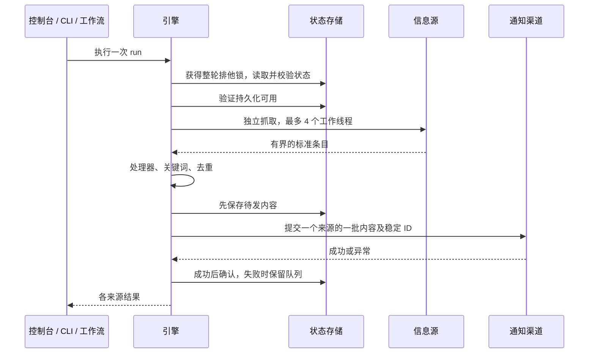

# 底层架构与 DIY 扩展指南

[English](../en/architecture.md) · [使用指南](guide.md) · [配置参考](../configuration.md)

InfoRelay 采用个人、单写入者的信息流架构。本地控制台、CLI 和 GitHub 工作流共用同一个引擎。0.2 版提供可替换、可验证的模块边界，适合继续扩展；它不是分布式调度平台，也不是多人 SaaS 后端。

## 模块边界

| 模块 | 负责什么 | 边界 |
|---|---|---|
| `config.py` | 参数校验、默认值、已注册插件引用 | 不通过 JSON 导入任意代码 |
| `plugins.py` / `builtins.py` | 带版本的接口、注册与内置适配器 | 不自动安装第三方包 |
| `sources.py` / `net.py` | 公开来源解析、有界网络请求 | 不负责调度与投递状态 |
| `engine.py` | 基线、筛选、去重、待发队列、独立来源报告 | 不处理 UI 和各渠道鉴权细节 |
| `delivery.py` | 绑定通知渠道、生成稳定批次 ID | 成功前不能删除待发条目 |
| `storage.py` / `state.py` | 排他锁、检查点格式、原子 JSON / SQLite 存储 | 不提供分布式锁 |
| `cloud.py` | 加密 Git 检查点同步 | 不保存本地控制台配置 |
| `service.py` / `server.py` | 本地操作、串行定时检查、回环地址 API | 不作为公网服务 |
| `web/` | 中英文向导和云端配置导出 | 不加载 Python 插件 |



云端检查点回调会在发送前、成功确认后推送加密快照。持久化失败会停止后续投递。单来源获取失败不会阻断其他来源，其已有待发队列仍可重试。

## 扩展接口：API version 1

接口位于 `info_relay.plugins`，通过 `Registry` 注册。内置功能也使用同一套接口。

### 信息源 SourcePlugin

```python
SourcePlugin(fetch, validate, mode="stream")
```

- `validate(source)` 校验并可规范化来源参数。扩展专属参数放在 `source["options"]` 中。
- `fetch(source, now)` 返回最多 1000 个标准条目的列表。`now` 带时区。网络、鉴权或解析失败时抛异常；成功返回 `[]` 表示真实的空基线。
- `stream` 按稳定条目 ID 去重；`snapshot` 检测每次内容转换；`daily` 使用每个本地日期一次的门控，必须用 `item(now.date().isoformat(), ...)` 生成当天唯一条目，到时段前返回 `[]`。
- 不同来源可能并发抓取。适配器应无状态或内部线程安全，并限制请求超时和响应大小。

用 `info_relay.sources.item(identity, title, body, url="", published="")` 构建条目。它会哈希稳定身份并规范化文字。运行时再次检查字段：

| 字段 | 约定 |
|---|---|
| `id` | 64 位小写 SHA-256 十六进制字符串 |
| `title` | 非空纯文本，最多 300 字符，不含控制字符 |
| `body` | 纯文本，最多 10000 字符 |
| `url` | 空串或受支持的公开 HTTP(S) URL，最多 2000 字符 |
| `published` | 纯文本，最多 100 字符 |

来源提供稳定 ID 时优先用它，不要用会变化的标题作为 stream 身份。网页 snapshot 的身份应覆盖完整提取文字，正文保存仍受长度限制。

### 处理器 ProcessorPlugin

```python
ProcessorPlugin(process, validate)
```

`process(item, options)` 接收条目副本，返回符合格式的条目或 `None`（丢弃）。必须保留 ID。处理器按配置顺序执行，之后才进行关键词匹配。丢弃的 stream 条目仍标记已见，不会每轮重新考虑；处理器异常则保留原来源检查点并报告失败。

内置 `prefix` 处理器可给标题加前缀：

```json
"processors": [{"type": "prefix", "options": {"text": "[阅读] "}}]
```

处理管线参与来源指纹。还有待发内容时修改管线会暂停该来源；先恢复原配置并清空队列，再调整。

### 通知渠道 ChannelPlugin

```python
ChannelPlugin(send, validate, diagnose=None)
```

`send(options, subject, body, batch_id)` 只有在目标已可靠接受内容后才能返回，否则抛异常。异常时引擎保留待发内容。相同来源、相同顺序条目组成的批次具有稳定 `batch_id`，供目标幂等去重。修改批量大小会改变批次边界，条件允许时按条目 ID 去重更强。

`validate(options)` 不能发送通知；可选 `diagnose(options)` 用于无发送的连接检查。内置 `email` 和 `file` 渠道。`file` 原子写入 `<batch_id>.json`，相同批次重试会覆盖同一文件。

一份配置使用一个渠道。需要多渠道分发时，应实现一个持久记录各目标确认结果的渠道插件。直接循环调用多个渠道，在部分失败后全量重试，会导致已成功目标重复收到。

### 状态存储 CheckpointStore

实现 `info_relay.storage.CheckpointStore`：

```python
class MyStore:
    def load(self) -> dict: ...
    def save(self, data: dict) -> None: ...
    def lease(self): ...  # 上下文管理器：独占整个抓取—发送—确认周期
```

- `load` 返回 `state.checked` 接受的格式，必须保存完整待发快照，而不只是 ID。
- `save` 必须原子、持久、校验容量，失败时抛异常。
- `lease` 覆盖整轮操作；仅在数据库写入时加事务不能阻止并发重复发送。
- 损坏状态必须报错，不能静默当成空状态。
- 默认 `JsonStore` 使用原子替换与 fsync。`SQLiteStore` 以单条事务记录保存相同格式。文件锁仅协调同机进程，不是分布式锁。
- 加密 Git 回调只适用于 JSON 文件。自定义 store 自行负责持久化，不能同时绑定该回调。

```sh
python -m info_relay run --config examples/diy.json \
  --storage sqlite --state .inforelay/diy.sqlite3
```

JSON 和 SQLite 不会自动互相迁移。先停旧任务，再明确建立新基线，或使用校验后的格式实现受控导入导出。

## 可运行的插件示例

[`examples/custom_plugin.py`](../../examples/custom_plugin.py) 同时演示三个扩展点：

```python
INFO_RELAY_API = 1

def register(registry):
    registry.source("json_feed", SourcePlugin(fetch_feed, validate_feed))
    registry.processor("min_words", ProcessorPlugin(enough_words, validate_words))
    registry.channel("markdown", ChannelPlugin(write_markdown, validate_directory))
```

从仓库根目录执行：

```sh
python -m info_relay plugins --plugin examples.custom_plugin
python -m info_relay check --config examples/plugin.json --plugin examples.custom_plugin
# 将 example.com 地址替换为你控制的公开 JSON 列表后：
python -m info_relay preview --config examples/plugin.json --plugin examples.custom_plugin
```

JSON 来源格式为 `[{"id":"1","title":"Example","body":"At least five words of useful text","url":"https://example.com/post"}]`。`examples/plugin.json` 是结构示例，地址不是现成数据服务；`examples/diy.json` 中的 RSS → 文件示例可直接联网运行。

第三方插件先安装到运行环境，再显式加载。也可以设置 `INFO_RELAY_PLUGINS=package.module,another.module`。没有自动扫描、远程代码下载或订阅 JSON 中的导入路径。注册失败不会保留一半插件，重名会拒绝。插件是可信 Python 代码，不在沙箱中运行。

## 嵌入自己的 Python 程序

```python
from info_relay import config, engine
from info_relay.plugins import Registry
from info_relay.builtins import register
from info_relay.storage import SQLiteStore

registry = Registry()
register(registry)
# 在这里注册自己的扩展。
cfg = config.load("examples/diy.json", registry)
reports = engine.run(cfg, registry=registry,
                     store=SQLiteStore(".inforelay/embedded.sqlite3"))
```

`engine.run` 还接受 `now`、`fetcher` 和兼容旧测试的 SMTP `sender` 注入参数。自定义通知渠道优先通过 registry 注册。测试使用固定数据和模拟发送，不面向真实收件人。

## 打包、部署与开发

- `python start.py`：建立项目虚拟环境，打开本地向导。
- `python -m pip install .`：安装 CLI `inforelay`。当前从源码或 wheel 安装，不代表已经发布到 PyPI。
- `python -m pip wheel --no-deps . -w dist`：构建 wheel，包含静态页面和示例配置。
- 常驻运行：`inforelay watch ...`、Docker Compose，或系统调度器定期调用 `run`。
- GitHub Actions：独立的启用开关、Secrets、加密状态，与旧邮件任务分开。

```sh
python -m pip install -r requirements.txt
python -m unittest -v
node --check web/app.js
node test_web_model.js
```

测试覆盖投递失败、状态损坏、容量限制、网页转换、插件注册、自定义渠道、SQLite、本地 API 边界和调度生命周期。CI 在 Linux 的 Python 3.9 / 3.13 上运行完整测试，在 Windows 上运行扩展与控制台测试。

## 兼容与升级

- 订阅 JSON 与检查点仍为 `version: 1`。未添加新选项时，旧版内置信息源的指纹保持一致。
- 插件 API 显式声明版本 1。不兼容接口变更需要新的 API 版本和迁移说明；未列为接口的内部辅助函数不承诺稳定。
- 项目仍为 0.x，升级前请阅读更新记录。经过测试的接口不能证明任意第三方插件都安全或兼容。
- 先停止调度、备份私有配置和状态，再更新代码与依赖；运行 `check` / `diagnose` 后恢复。保留来源 ID 和加密密钥。
- 修改 URL、筛选器、处理管线或目标渠道时，需要考虑待发数据迁移；先恢复原设置并排空队列。修复邮箱授权码不需要清空状态。

## 安全与运行边界

本地服务仅监听回环地址，采用明确的静态资源允许列表、精确 Host / Origin 检查、每进程会话令牌、有界 JSON 请求、不开放 CORS、不记录含凭据的请求日志。读取配置 API 不返回已保存的密码。不要通过隧道或反向代理暴露它。

内置来源拒绝私有地址并检查跳转，内容始终作为文本处理，不执行为代码或 HTML。插件可能绕过这些工具，作者需负责相应安全边界。私有配置、导出文件和状态不应进入代码仓库。详见 [安全政策](../../SECURITY.md)。
